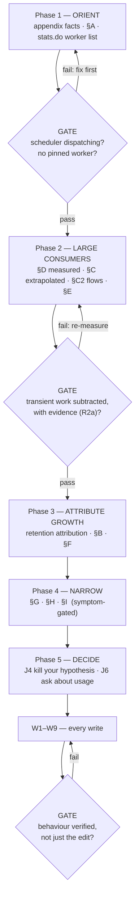

# diag-playbook

Verified: 2026-10-21

A portable triage procedure for instance performance and data growth: log bloat,
runaway scheduled jobs, batch-load contention, queue backlogs, and query/ACL
cost. You arrive with a **state** — a symptom, a failure — not a topic. **Enter
through the router**, read selectively, and load only the modules its row names.

## Companions you need before you start, not mid-triage

| Companion | What it owns | Reachability |
|---|---|---|
| `admin` on the target instance, and the ability to run read-only server-side scripts | every probe in this skill | prerequisite |
| Ability to fetch `https://<instance>/stats.do` | servlet memory, semaphore queue depth/rejections, OS load, DB pool, response-time percentiles, scheduler queue length and worker state — **these exist nowhere else** | prerequisite |
| `sn-product-docs-github` *(hint record)* | grounding a claim in official product docs, and the `web_fetch` fabrication traps | **its safe procedure is inlined** into `T3` in `references/tooling-and-judgement.md`, so this skill stands alone |
| `sn-roles-acls` *(hint record)* | the ACL **authoring** side — role hierarchy, table/field patterns, the Fluent `ACL()`/`Role()` shape, and the grounded doc sources | pointer only; `§H` does not restate it |
| `sn-glideaggregate-minmax` *(hint record)* | full detail on the `MIN`/`MAX`/`AVG` defect | pointer only; the rule and its evidence are in `T6` |
| `update-system-property` *(skill)* | any property change a triage concludes is needed (`R8`) | skill |

⚠ The three hint records are retrieved via a Hints MCP server and are **not
reachable from every workspace**. Nothing in this skill's procedure depends on
them; they add depth, not correctness.

## When to use

- A performance or growth symptom has been reported — find the row in the router.
- A general health check with no clear symptom → `§A`, then the `§I` sweep.
- You need to know whether a schedule or retention change actually worked.
- You are about to delete, deactivate or reduce retention on anything and want
  the write rules.

## When NOT to use

This procedure ranks **consumers of instance capacity**. Applied to an adjacent
problem it will mis-diagnose it.

| Not this skill | Why, and where it belongs |
|---|---|
| **One specific query is slow** | that is query/index tuning on a known statement. This skill finds *which* consumer costs the instance; it does not optimise a statement you already have |
| **A functional bug** — wrong value, rule not firing, client script inert | nothing here measures correctness, only cost |
| **Build, Fluent or deployment failures** | different tooling entirely |
| **Login, SSO or authentication failures** | not a capacity problem |
| **Changing a system property** | `update-system-property`. `R8` governs *whether*; that skill governs *how* |
| **Authoring ACLs or roles** | `sn-roles-acls`. `§H` only measures per-row read **cost** |
| **A slow EXTERNAL endpoint** | `M-7` will name it, and then stop: the levers are caching, async, or removal — **not** tuning ServiceNow. Do not imply a config fix exists |
| **An instance that is hibernated, suspended or idle** | `§A` will read as a stalled scheduler. Ask the user first; otherwise every downstream conclusion inverts |

## Normative vs EXAMPLE — read this before any figure

- **Procedure and rules are normative.** Follow them on every instance.
- Blocks marked **`EXAMPLE`** are illustrations from real runs. Their numbers are
  **evidence that the method works, NEVER values to reuse.** Every instance
  differs; re-measure. 🛑 Do not convert an `EXAMPLE` figure into a threshold or a
  recommended value.
- The `EXAMPLE — my own error` blocks and the false-positive pairs are the
  highest-value entries in this skill. They record what a confident wrong answer
  looked like.
- **Every field claim keeps its evidence strength inline** — `reproduced xN`,
  `observed once`, `counter-data:`, `undocumented`, `inferred`. Read the label,
  not just the rule. Where a claim carries counter-data, the counter-data is part
  of the claim.
- ⬜ marks residual uncertainty **at the claim**, each with a concrete
  **Verify by:** instruction. There are four: `T2`, `T6` and the closing limit on
  intent/frequency claims in `references/tooling-and-judgement.md`, and `§H`
  step 3 in `references/procedure-phase4-narrow.md`.

## SYMPTOM ROUTER — entry by reported symptom

Find the state as it presents. **`§A` runs first on every row but one**, then work
the chain left to right. The **Read first** column is not optional reading: each
entry names the single mechanic that most often produces a **WRONG** conclusion
on that specific path.

| The state, as it presents | First — mandatory | Then, in order · files to LOAD | Read first — or you will get this wrong |
|---|---|---|---|
| "The instance feels slow" / users complain of slowness; no single culprit | **`§A`** | `§D` → `§C` → `§C2` → `§E` · `procedure-phase1-orient` + `procedure-phase2-consumers` + `probes-phase1` + `probes-phase2` | **`M-4`** — memory, semaphores, queue depth and worker state exist *only* on `stats.do`; **and `§C2`** — flows are structurally invisible to `§C`, so a `§C` total presented as "the scheduler load" is incomplete by an unknown amount |
| "A log table is growing" — `syslog`, `sysevent`, `syslog_transaction` | **`§A`** | retention attribution → `§B` → `§I` debug properties · `procedure-phase3-growth` + `mechanics` (`M-1`, `M-2`) + `procedure-phase4-narrow` + `probes-phase3` | **`M-1` + `M-2`** — rotation and flush do **not** stack, a flush policy on a rotated table is dead config, and **never sum a parent class with its children** |
| "The log is full of **errors**", not just volume | **`§A`** | `§B` error attribution → `§I` debug properties · `procedure-phase3-growth` + `probes-phase3` | **`§B`** — bucket by *distinct normalised pattern* and weight by the **top pattern's share**. Many patterns ≠ many faults, a diffuse spread is usually unconfigured features (`R7`), and `source = '*** Script'` rows are **your own probes echoing** |
| "Disk pressure" / "can we retain less?" | **`§A`** | `§B` **baseline trends FIRST** → `§I` → (write) `W1`–`W9` · `procedure-phase3-growth` + `mechanics` (`M-1`) + `write-safety` + `probes-phase3` | **`M-1`** — 🛑 never cut retention below the **10-day `§B` analysis window**, and shard `duration` sets a hard floor you may not be able to reach. Capture the trend *before* reducing, or you permanently lose the ability to attribute the table's own volume |
| "Audit volume" / `sys_audit` churn | **`§A`** | `§I` audit row → `§B` · `procedure-phase4-narrow` + `mechanics` (`M-1`) + `probes-phase4` | **`§I`** — a 24-hour aggregate cannot tell a steady producer from a burst. Measure the **live rate** over 15–30 min, and check whether **your own** bulk change caused it. Also confirm the mechanism exists: a table may already have `audit = 0` |
| "A job never finishes, or hangs" | **`§A`** | `§E` → `§D` · `procedure-phase1-orient` + `procedure-phase2-consumers` + `probes-phase2` | **`M-3`** — never report a schedule from the field you set; `next_action` is the only authority. **And `§E`:** print **claim age**, not `processing_duration` — that field is the last *completed* pass, so a worker wedged right now shows a small duration |
| "Installs / queued operations never start"; UI shows perpetual "In progress" | **`M-5`** *(not `§A`)* | `§A` → `§E` · `mechanics` (`M-5`, `M-6`) + `procedure-phase1-orient` + `write-safety` | **`M-5`** — the lock holder may be a **SINGLE** row naming a node absent from `sys_cluster_state`, so clearing the queued items achieves nothing. The same `sys_id` can exist in several tables, and "non-terminal" is more than one state |
| "A job fires far too often" | **`§A`** | `§E` epoch `run_start` → `§C` churn ranking · `procedure-phase2-consumers` + `probes-phase4` (probe 7) | **`§E` false-positive guard** — a 1970s `run_start` is *usually normal*. Require epoch **`next_action`** *and* cadence ≫ configured. `trigger_type 10` heartbeats legitimately show epoch `next_action` |
| "A queue or event backlog is growing" | **`§A`** | `§F` draining-vs-stuck → `§E` if stuck · `procedure-phase3-growth` + `mechanics` (`M-6`) + `probes-phase3` | **`§F`** — bucket the rate with **one `GlideAggregate` COUNT per bucket**; a capped row loop truncates the oldest buckets and can invert the verdict. And get the oldest pending item from a bounded **COUNT ladder**, never `orderBy` + `setLimit(1)` on a rotated table |
| "A sync or import job is slow / slowing over time" | **`§A`** | `§G` — distinguish **G1 vs G2** → `§D` · `procedure-phase4-narrow` + `probes-phase4` | **`§G` tells** — G1 is `staging ≫ target` with staging spanning many runs; G2 is `target ≫ distinct(composite key)` **plus** `business_rule_time ≫ sql_time`. Wrong branch ⇒ the fix does nothing. `staging = 0` is the **healthy** state, not duplication |
| "List or form views are slow on one table" | **`§A`** | `§D` → `§H` → `§I` form weight · `procedure-phase2-consumers` + `procedure-phase4-narrow` + `probes-phase4` | **`§H` step 3** — check for a **query-time fast path** *before* touching any ACL. If it is on, every per-row branch is already dormant and the answer is no change |
| "Suspected ACL / per-row read cost" | **`§A`** | `§H` → `§D` step 3b for the background surface · `procedure-phase4-narrow` + `procedure-phase2-consumers` + `probes-phase4` | **`§H` steps 1–2** — read ACLs are **role-gated first**, and many scripted ACLs are **row-scoped by design**. Converting those to role-only is a **data-exposure regression**, not an optimisation |
| "A job is slow but `sql%` and `br%` are both near zero" | **`§A`** | `§D` step 3b decomposition → `M-7` if the residual persists · `procedure-phase2-consumers` + `mechanics` (`M-7`) + `probes-phase2` (2b, 2c) | **`§D` step 3b** — the residual has a **name**: CPU, ACL, semaphore wait, session wait, MetricBase, or an external call. Do not force it into the SQL-vs-BR dichotomy. An **absent** component field reads VOID, never zero, and a **negative** UNACCOUNTED is real double-counting |
| "A request just stops" — nothing in the cost data | **`§A`** | `§D` step 3d → `§D` step 3c · `procedure-phase2-consumers` + `probes-phase4` (probe 7) | **`§D` step 3d** — a killed transaction consumes almost no time and **may never be written to `syslog_transaction`**, so it is structurally invisible to `§C`, `§D` and `§C2`. The evidence is log TEXT: `message STARTSWITH 'Cancelling'` — **not** `%cancel%` |
| "Batch load lands inside working hours" | **`§A`** | `§C` step 5 → `§C` step 6 · `procedure-phase2-consumers` + `mechanics` (`M-3`) | **`M-3`** — establish the `run_time`→GMT offset **empirically, per job class**; for some classes `run_time` is decorative and editing it moves nothing. **And ask the user their hours** (`J6`) |
| "We changed a schedule / retention — did it work?" | **`W7`** *(no `§A`)* | `W8` → `W9` · `write-safety` | **`W8`** — a verification window must **exceed the old period's span**, or you are reporting a projection as an achieved result. And `W9`: write-rate reduction ≠ size reduction |
| "Nothing obviously wrong" / general health check | **`§A`** | `§I` sweep · `procedure-phase1-orient` + `procedure-phase4-narrow` + `probes-phase1` + `probes-phase4` | **`J2`** — "measured, healthy, no change" is a **successful outcome**. Report it with the same rigour as a fix (`R7`) |

### Router rules

1. **`§A` is never skippable on any diagnostic chain.** Two rows start elsewhere:
   installs-never-start begins at `M-5` and still reaches `§A`; only the
   "did it work?" row is pure verification and has no `§A`.
   A stalled scheduler is indistinguishable from "the problem fixed itself" —
   volume drops because jobs *stopped*, not because anything improved. Skip it and
   **every downstream conclusion inverts and every fix is inert.**
2. **Two rows matching ⇒ run both chains.** `§G`'s G1 vs G2 is the proof that
   similar symptoms need different fixes (`J5`).
3. **Any chain ending in a write continues into `references/write-safety.md`
   (`W1`–`W9`). No exceptions.** The rows most likely to get there: disk
   pressure, installs-never-start, a job firing too often, and sync bloat.
4. **These modules apply THROUGHOUT, not at one step** — load them once, early:
   `references/operating-rules.md` (`R1`–`R9`),
   `references/tooling-and-judgement.md` (`T*` and `J*`), and
   `references/probes-conventions.md` before running any probe. Before
   concluding anything, run `J4`: state your hypothesis and try to disprove it.
5. **Anchors are unique only WITHIN a file.** Every cross-file reference in this
   skill names the file as well as the anchor. Never cite a bare anchor, and never
   "see above/below".

## Phased execution flow — the default path for a general sweep

Each phase ends in a **gate**. If a gate fails, resolve it before continuing —
every later measurement inherits the error.

| Phase | Steps | Gate |
|---|---|---|
| **1 — ORIENT** *(always; cheap)* | appendix per-instance facts → `§A` → `stats.do` worker list | 🚦 A stalled scheduler or a pinned worker must be fixed **first**. A stalled scheduler makes every downstream conclusion inert; a pinned worker silently removes capacity from every later measurement |
| **2 — CONSUMERS** *(measure; never extrapolate)* | `§D` first wherever `syslog_transaction` is readable **in any scope** → `§C` cost-weighted, **no duration floor** → `§C2` flows → `§E` runaway/stuck | 🚦 Subtract transient work before calling any total steady state — and "transient" is a **claim requiring evidence** (`R2a`), not a default |
| **3 — GROWTH** *(only if a table is growing)* | retention attribution against the 10-day floor → `§B` rate then a 10–14 day series → `§F` rate history | 🚦 One window is never actionable, and a bucket older than measured retention is a **pruned shard**, not a volume signal |
| **4 — NARROW** *(symptom-gated; skip unless indicated)* | `§G` (G1 vs G2) → `§H` (fast path first) → `§I` by symptom | — |
| **5 — DECIDE, THEN WRITE** | `J4` state and try to disprove your hypothesis → `J6` ask about usage → `W1`–`W9` | 🚦 Verify the **behaviour**, not the edit. A value landing in a field proves nothing about what it does |

🛑 **Never add the `§C` and `§C2` totals** — the flow engine's handler job *is*
the flow execution. And `§D` is authoritative over `§C` for frequent jobs; `§C`
covers only the rare ones `§D` cannot see.

## Prerequisites

- `admin`, and the ability to run read-only server-side scripts.
- `https://<instance>/stats.do` fetchable (some metrics exist nowhere else).
- The per-instance facts in the appendix at the end of
  `references/procedure-phase1-orient.md`. **They are different on every
  instance** — establish them before diagnosing, not mid-triage.
- Every probe is read-only except probe 4 in `references/probes-phase3.md`, which
  ships `DRY_RUN = true`.

## Module index

| File | Holds | Read cost |
|---|---|---|
| `references/operating-rules.md` | `R1`–`R9` — read-only first, measure don't infer, validate fields, reversibility, vendor code, escalation, do-no-harm, properties, trust artefacts. **Applies throughout** | ~8 KB |
| `references/mechanics.md` | `M-1` retention · `M-2` class hierarchies · `M-3` job timing · `M-4` `stats.do`-only metrics · `M-5` stale node identity · `M-6` queues with no backing table · `M-7` outbound latency | ~32 KB |
| `references/procedure-phase1-orient.md` | `§A`, the `stats.do` worker-list check, and the **per-instance appendix** | ~6 KB |
| `references/procedure-phase2-consumers.md` | `§C` scheduler load · `§C2` flow runtime · `§D` transaction & query cost (3b decomposition, 3c pools, 3d cancellations) · `§E` runaway and stuck | ~41 KB |
| `references/procedure-phase3-growth.md` | retention attribution ordering · `§B` volume and error attribution · `§F` draining-vs-stuck | ~12 KB |
| `references/procedure-phase4-narrow.md` | `§G` sync bloat · `§H` ACL cost · `§I` housekeeping sweep | ~17 KB |
| `references/write-safety.md` | `W1`–`W9` — deletes and verification windows. **Every write goes through here** | ~6.5 KB |
| `references/tooling-and-judgement.md` | `T1`–`T7` + `T2a` verified tool failures · `J1`–`J6` judgement. **Applies throughout** | ~15 KB |
| `references/probes-conventions.md` | the twelve probe conventions and two helpers. **Read before running or writing any probe** | ~6 KB |
| `references/probes-phase1.md` | probe 1 — orient | ~2.5 KB |
| `references/probes-phase2.md` | probes 2, 2b, 2c, 5 — consumers, decomposition, outbound, stuck-vs-slow | ~19 KB |
| `references/probes-phase3.md` | probe 3 — growth; probe 4 — **the one guarded WRITE** | ~20 KB |
| `references/probes-phase4.md` | probes 6a, 6b, 6c, 7 — sync bloat, ACL, housekeeping, remaining sweep | ~26 KB |
| `references/test_prompts.md` | trigger / edge / non-trigger prompts | ~5.5 KB |

**Anchor prefixes, one meaning each:** `R` operating rules · `M` mechanics ·
`§` procedure sections · `W` write and verification rules · `T` tooling ·
`J` judgement.
